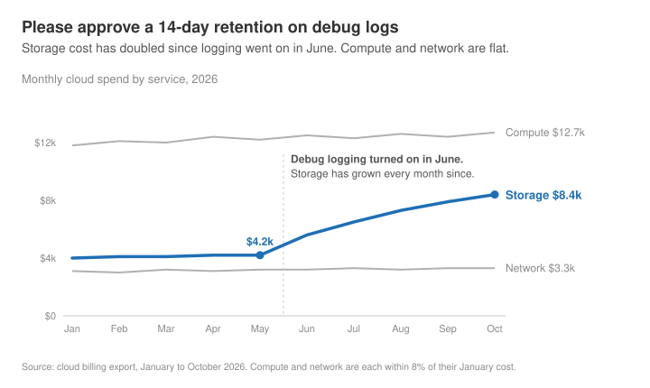
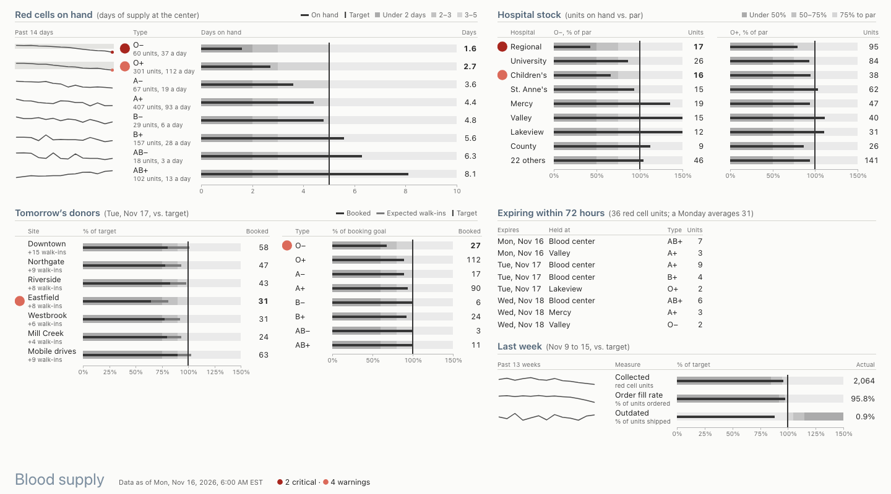

# repertoire

Skills for coding agents, published as Claude Code plugins. Each is also a plain skill directory with a `SKILL.md`, scripts, and references, so any runner that follows the open agent skill standard can load it.

| Plugin | What it does |
|---|---|
| [`sidework`](plugins/sidework/) | Runs a task on its own branch in a git worktree beside your checkout. Leaves your checkout untouched. |
| [`build-review-lens`](plugins/build-review-lens/) | Reads a repository's PR history to find who reviews and what passes, then writes a lens skill for each reviewer to review your branch as that maintainer would. |
| [`data-story`](plugins/data-story/) | Turns numbers into a point a reader gets in seconds and can act on, by answering the questions *Storytelling with Data* asks before anything is drawn. |
| [`data-dashboard`](plugins/data-dashboard/) | Builds, fixes, and reviews dashboards the way Stephen Few's *Information Dashboard Design* teaches: one screen read at a glance, every measure against its comparison, and color only for what needs attention. |
| [`write-with-style`](plugins/write-with-style/) | Writes and edits prose by Strunk's *The Elements of Style* (1918): the point first, a topic sentence to open each paragraph, definite sentences in the active voice, and no needless words. |

## Install

As Claude Code plugins:

```
/plugin marketplace add johncarmack1984/repertoire
/plugin install sidework@repertoire
/plugin install build-review-lens@repertoire
/plugin install data-story@repertoire
/plugin install data-dashboard@repertoire
/plugin install write-with-style@repertoire
```

For any agent that reads skills, with the skills CLI:

```
npx skills add johncarmack1984/repertoire
```

Or as personal skills, from a clone:

```sh
git clone https://github.com/johncarmack1984/repertoire
ln -s "$PWD/repertoire/plugins/sidework/skills/sidework" ~/.claude/skills/sidework
ln -s "$PWD/repertoire/plugins/build-review-lens/skills/build-review-lens" ~/.claude/skills/build-review-lens
ln -s "$PWD/repertoire/plugins/data-story/skills/data-story" ~/.claude/skills/data-story
ln -s "$PWD/repertoire/plugins/data-dashboard/skills/data-dashboard" ~/.claude/skills/data-dashboard
ln -s "$PWD/repertoire/plugins/write-with-style/skills/write-with-style" ~/.claude/skills/write-with-style
```

## sidework

Claude Code's own worktrees go in `.claude/worktrees/`, inside the repository, where Cargo, just and Node all see the checkout's config on top of the branch's. sidework puts each task's worktree beside the checkout instead. The table of what breaks nested, and the lab script that reproduces it, are in [its README](plugins/sidework/README.md).

## Review lenses

A review lens turns evidence of a maintainer's reviews into a review you can run before theirs. `build-review-lens` reads a repo's PR history, giving more weight to the last six months, to find who actually reviews and what passes. It writes a `<name>-lens` skill that reviews your branch as that maintainer will, leaving them nothing to flag when the PR opens.

The evidence comes from review habits. CONTRIBUTING.md describes the project maintainers want; merged PRs and their comments show the project they run. Once one repo's lens was tuned, PRs started merging on sight. A neighboring repo with a different maintainer kept sending the same comments back.

The mining script ranks reviewers by activity, weighted toward recent reviews. It shows who merges and how long outside contributors wait by PR size, then collects every word from each top reviewer, grouped by PR. A few merged PRs are held back to test the finished lens against comments it hasn't seen. The lens is one file: steps, rules backed by verbatim evidence and PR numbers, and pitfalls the repo's CI never spells out. The lens template, the evidence template and the refinement loop are in [`reference/`](plugins/build-review-lens/skills/build-review-lens/reference/).

## data-story

A reader gives a page of numbers a few seconds before deciding whether to keep reading. `data-story` loads when an agent is about to put numbers in front of someone: a chart, a table, a slide, or results going into a PR description, a README, or a report. Before anything is drawn, the agent answers the questions Cole Nussbaumer Knaflic's *Storytelling with Data* asks: who is the one reader, what should they do when they finish, and what is the point in one sentence.



Then it builds one lesson of the book at a time, with each step reading its chapter's file when the step starts. A chooser picks the visual from the dozen the book uses, by what the reader needs to see: a sentence for one or two numbers, a table for values to look up, a line for change over time, bars from zero for categories, and no pies. Only the chosen visual's file loads, and the main file is half its old length. What doesn't help the reader is cut, the accent color goes to the data the title talks about and to nothing else, and the title says the conclusion or the ask. The chart above is one of two the skill includes as models.

When the visual is ready, every line the reader will read goes to `write-with-style` with a list of what the edit has to keep: every number, every caveat, and the number that cuts against the point. `write-with-style` installs with `data-story` as a dependency. Before the piece goes out, the agent recomputes every number the words claim and gives it to a reader who has no context.

Eight of its evals are the book's own examples: the pilot science program's budget request, the ticket backlog behind a hiring request, ten design concerns of which three are noise, five products' prices leading to a recommendation, a tax-rate chart whose axis starts at 34%, and chapter 2's examples of a slopegraph, a waterfall, and a scatterplot. Three more are benchmark numbers for a PR: raw runs that belong in one table, one before and after that stays a sentence, and a run set with two slow outliers where a mean would mislead. Each case also checks that the run read no visual it didn't choose.

The table rules still follow Stephen Few's *Show Me the Numbers* and the measurement rules Martin Kleppmann's *Designing Data-Intensive Applications*, each loaded only when the piece needs it. The skill's [`reference/sources.md`](plugins/data-story/skills/data-story/reference/sources.md) maps each file to its chapter.

## data-dashboard

A dashboard is read at a glance or not at all. `data-dashboard` loads when an agent is asked for a dashboard, a KPI or metrics page, a scorecard, or a monitoring screen, or to fix or review one. It designs by Stephen Few's *Information Dashboard Design* (2006): one screen with nothing to scroll, every measure against its target, prior period, or normal range, bullet graphs and sparklines where most dashboards put gauges and bare numbers, and color kept for the few things that need action.



The agent draws nothing by hand. The skill ships a small library that draws Few's display media as SVG, so every bullet graph and sparkline follows the geometry measured from his figures, and the page needs no network. A check script renders the page in headless Chrome and fails it when it scrolls, clips or overlaps text, draws a pie, or shows a number with nothing to compare it to, naming Few's mistake each time. The agent then looks at the screenshot before it reports.

Asked to fix a dashboard, the skill keeps every measure and rewrites the presentation, in place for Recharts, Chart.js, ECharts, Vega-Lite, or Grafana, or as a new page. Asked to review one, it cites Few's thirteen mistakes by number, gives each fix in a line, and marks nothing that keeps the rules.

Four of its evals are the situations in the book's chapter 8: the sales manager's dashboard, the CIO's, the web marketing analyst's, and a sales dashboard full of chapter 3's mistakes to fix. A fifth reviews a Grafana dashboard, and a sixth checks that a single chart for a README goes elsewhere. The skill's [`reference/sources.md`](plugins/data-dashboard/skills/data-dashboard/reference/sources.md) maps each step to its chapter and lists where the skill departs from the 2006 book.

## write-with-style

An agent writes prose that people have to read: PR descriptions, commit messages, READMEs, issues, review comments, and email. `write-with-style` loads before it writes any of that, and when it's asked to tighten, edit, or review a draft. It edits by the rules of William Strunk Jr.'s *The Elements of Style* (1918). The point comes first, in one sentence. Each paragraph opens on its topic sentence and ends on its consequence. Each sentence makes a definite assertion in the active voice and ends on its news. Every word tells.

The rules are the book's, cited by its own numbers, with Strunk's examples quoted, since the 1918 text is in the public domain. Where usage has changed since 1918, the skill says so and follows today's: *they* for a person of unknown gender, a comma before *so*, and *today* without its hyphen. Because editors reflow text and spell checkers catch typos, line-end hyphenation is out, and the spelling list shrinks to the pairs a checker misses. The skill's [`reference/sources.md`](plugins/write-with-style/skills/write-with-style/reference/sources.md) maps each rule to its chapter, lists every departure with its reason, and marks which lines are the skill's reading rather than Strunk's.

A revision keeps every fact, figure, name, link, and code span, and cuts a prediction nobody has measured. A review quotes each fault, cites its rule, and gives the fix, the way Strunk meant his numbers to be used "in correcting manuscript." A sentence that keeps the rules gets no mark. The skill's evals grade three jobs: tightening an agent-written PR description without losing a fact, writing a README section from rough notes, and reviewing a docs page with five planted faults and two sentences that only a 1918 reading would mark.

## Development

`just validate` checks the marketplace and every plugin with `claude plugin validate --strict`. `just lint` runs shellcheck over sidework's scripts and the eval scaffolds, and compiles the lens miner. `just eval sidework`, `just eval data-story`, `just eval data-dashboard`, and `just eval write-with-style` run those plugins' eval suites, `just dashboards` checks data-dashboard's template, components page, and worked example in headless Chrome, and `just lab` reproduces the nested-worktree failures. CI runs the same checks on every push and pull request; the evals workflow runs on demand and needs an `ANTHROPIC_API_KEY` secret.
